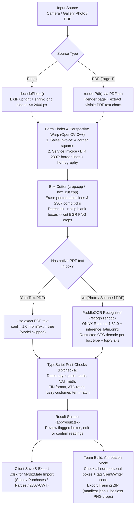
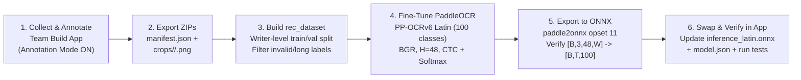

# MyBizMate Scan — OCR Recognition Training Workflow

Reference for how MyBizMate Scan reads form fields and how to retrain, export, and verify its text recognition model (`inference_latin.onnx`).

---

## 1. High-Level Architecture Overview

**MyBizMate Scan** is an offline Expo / React Native mobile app backed by a local C++ native module (`modules/scanner`). Nothing leaves the phone except `.xlsx` import sheets or `.zip` training exports that the user explicitly shares.

It reads **three Philippine business forms** from live camera photos, gallery images, or PDFs:
1. **MyBizMate Sales Invoice** (`sales_invoice`) — aligned using its 4 printed corner squares ([field_map.json](file:///c:/Users/Keith/Desktop/OCR%20BIZMATE/modules/scanner/assets/scanner/field_map.json)).
2. **MyBizMate Service Invoice** (`service_invoice`) — aligned using its printed table border ([service_invoice.json](file:///c:/Users/Keith/Desktop/OCR%20BIZMATE/modules/scanner/assets/scanner/service_invoice.json)).
3. **BIR Form 2307 (Page 1)** (`bir_2307`) — aligned using its outer printed border ([bir_2307.json](file:///c:/Users/Keith/Desktop/OCR%20BIZMATE/modules/scanner/assets/scanner/bir_2307.json), 160 boxes).

### End-to-End Runtime Flow



---

## 2. Critical Fact Before Fine-Tuning: Recognition Only (No Detection Model)

Standard PaddleOCR pipelines run **two** neural networks (`PP-OCR_det` text detection + `PP-OCR_rec` text recognition).

**MyBizMate Scan does NOT use a PaddleOCR detection model (`det`) at all.**
- **Form detection, deskewing, line removal, and box cropping are 100% OpenCV geometry** inside [align.cpp](file:///c:/Users/Keith/Desktop/OCR%20BIZMATE/modules/scanner/cpp/core/align.cpp), [frame_aligner.cpp](file:///c:/Users/Keith/Desktop/OCR%20BIZMATE/modules/scanner/cpp/core/frame_aligner.cpp), [crop.cpp](file:///c:/Users/Keith/Desktop/OCR%20BIZMATE/modules/scanner/cpp/core/crop.cpp), and [box_cut.cpp](file:///c:/Users/Keith/Desktop/OCR%20BIZMATE/modules/scanner/cpp/core/box_cut.cpp).
- Every box crop handed to the neural network is **already a single horizontal text line** with printed borders and 2307 comb ticks erased to paper gray.
- **Only ONE model is shipped and fine-tuned:** the **Text Recognition (`rec`) model** at [inference_latin.onnx](file:///c:/Users/Keith/Desktop/OCR%20BIZMATE/modules/scanner/assets/scanner/inference_latin.onnx) (`PP-OCRv6 small, Latin cut`, ~12.15 MB).

---

## 3. Exact Technical Contract of `inference_latin.onnx`

When we fine-tune PaddleOCR and export back to ONNX, the exported model **must strictly match** what [recognizer.cpp](file:///c:/Users/Keith/Desktop/OCR%20BIZMATE/modules/scanner/cpp/core/recognizer.cpp) expects in C++:

| Property | Required Specification | Where Enforced |
|---|---|---|
| **ONNX File Path** | `modules/scanner/assets/scanner/inference_latin.onnx` (single file, no external `.onnx.data`) | [ScannerModule.kt](file:///c:/Users/Keith/Desktop/OCR%20BIZMATE/modules/scanner/android/src/main/java/expo/modules/scanner/ScannerModule.kt#L70-L79) |
| **ONNX Runtime / Opset** | ONNX Runtime Android `1.32.0`, ONNX Opset `11` (IR v6+), `float32` | [build.gradle](file:///c:/Users/Keith/Desktop/OCR%20BIZMATE/modules/scanner/android/build.gradle#L13) |
| **Input Tensor Shape** | `[batch, 3, 48, dynamic_width]` (`float32`, layout `NCHW`) | [recognizer.cpp](file:///c:/Users/Keith/Desktop/OCR%20BIZMATE/modules/scanner/cpp/core/recognizer.cpp#L152-L153) |
| **Color Channel Order** | **BGR** (`OpenCV cv::Mat` default — **do NOT train on RGB**) | [recognizer.cpp](file:///c:/Users/Keith/Desktop/OCR%20BIZMATE/modules/scanner/cpp/core/recognizer.cpp#L140-L150) |
| **Resize & Padding** | Height fixed to `48 px`; width `ceil(48 * w / h)` right-padded with `0.0f` to batch max width (minimum `320 px`); batch size up to `8` | [recognizer.cpp](file:///c:/Users/Keith/Desktop/OCR%20BIZMATE/modules/scanner/cpp/core/recognizer.cpp#L17-L18), [L130-L151](file:///c:/Users/Keith/Desktop/OCR%20BIZMATE/modules/scanner/cpp/core/recognizer.cpp#L130-L151) |
| **Pixel Normalization** | `(pixel / 255.0 - 0.5) / 0.5` → `[-1.0, +1.0]` | [recognizer.cpp](file:///c:/Users/Keith/Desktop/OCR%20BIZMATE/modules/scanner/cpp/core/recognizer.cpp#L146) |
| **Output Tensor Shape** | `[batch, time_steps, 100]` (`float32`) | [recognizer.cpp](file:///c:/Users/Keith/Desktop/OCR%20BIZMATE/modules/scanner/cpp/core/recognizer.cpp#L155-L156), [test_recognizer.cpp](file:///c:/Users/Keith/Desktop/OCR%20BIZMATE/modules/scanner/cpp/tests/test_recognizer.cpp#L22) |
| **Final Activation** | **Must end with `Softmax(axis=2)`** (outputs `[0..1]` probabilities, **not** raw logits, because `conf` averages top probs and `alts` checks `runnerUp > 0.02`) | [recognizer.cpp](file:///c:/Users/Keith/Desktop/OCR%20BIZMATE/modules/scanner/cpp/core/recognizer.cpp#L205-L219) |
| **Class Index Mapping (`100` total)** | `0` = `<blank>` (CTC blank)<br>`1..98` = 98 lines of [dict.txt](file:///c:/Users/Keith/Desktop/OCR%20BIZMATE/modules/scanner/assets/scanner/dict.txt) (`!`..`~` ASCII 33–126 + `É`, `Ñ`, `é`, `ñ`)<br>`99` = `" "` (space, i.e. PaddleOCR `use_space_char: true`) | [recognizer.cpp](file:///c:/Users/Keith/Desktop/OCR%20BIZMATE/modules/scanner/cpp/core/recognizer.cpp#L86-L96) |
| **Model Version Pin** | `modules/scanner/assets/scanner/model.json` must hold exact `name`, `sha256`, and `bytes` of `inference_latin.onnx` | [versions.ts](file:///c:/Users/Keith/Desktop/OCR%20BIZMATE/lib/versions.ts), [versions.test.ts](file:///c:/Users/Keith/Desktop/OCR%20BIZMATE/__tests__/versions.test.ts) |

### Per-Box Character Masks During C++ CTC Decoding

Even though the model outputs all 100 classes, `Recognizer::decode()` restricts CTC decoding to allowed columns per field type:
- `printed_digits` / `digits`: `0-9`
- `tin`: `0-9`, `-`
- `code`: `A-Z`, `0-9` (BIR 2307 ATC codes such as `WC158`, `WI010`)
- `amount`: `0-9`, `,`, `.`, `P` (captures handwritten peso prefix `P1,500.00`)
- `number`: `0-9`, `,`, `.`, `/`, `" "` (captures fractional quantities such as `1/2` or `1 1/2`)
- `date`: `0-9`, `/-., `, `A-Z`, `a-z` (plus a second `date_digits` pass on frame forms for backup readings)
- `text`: all 99 non-blank characters (`ASCII 32..126` + `Ñ`, `ñ`, `É`, `é`)

---

## 4. End-to-End PaddleOCR Fine-Tuning Workflow



> **Important Repository Note:** In `README.md`, helper scripts under `../prototype/training/` (`read_scan_exports.py`, `finetune_ppocrv6_rec.ipynb`) and `../prototype/benchmark/` lived outside this Git repository on the original author's machine. Everything needed inside the mobile app (`lib/training/`, `app/training.tsx`, `modules/scanner/assets/scanner/`) **is** included here, and we can recreate the Python dataset builder + fine-tuning scripts cleanly inside a `training/` or `scripts/` folder in this workspace.

---

### Step 1: Collect & Check Real Handwriting Scans (In-App Annotation Mode)

Because training crops must match the **exact perspective warp, rule-line removal, and padding** produced by C++ `crop.cpp` / `box_cut.cpp`, the best training data comes directly from the app's built-in **Annotation Mode**:

1. **Build & install a Team Build** on an Android phone (debug builds enable Team Tools automatically; for a fast release build on an `arm64-v8a` phone):
   ```powershell
   $env:EXPO_PUBLIC_TEAM_BUILD='1'
   cd android
   .\gradlew.bat app:assembleRelease -PreactNativeArchitectures=arm64-v8a
   adb install -r app\build\outputs\apk\release\app-release.apk
   ```
2. Open **⋮ → Settings → TEAM TOOLS → Annotation mode** and switch it **ON**.
3. Scan real handwritten **Sales Invoices**, **Service Invoices**, and **BIR Form 2307s**.
4. Tap every training box on the Result screen:
   - Tap **Looks right** if the model's reading is already 100% exact (`confirmed`).
   - Or type the exact written text and tap **Save** if the model misread it (`corrected`).
   - *Privacy by design:* Personal fields (`customer_name`, `customer_tin`, `customer_address`, `payee_*`, `payor_*`), multi-line stacked crops (`service_invoice` `amount_words`), and PDF-text boxes are automatically excluded ([lib/training/boxes.ts](file:///c:/Users/Keith/Desktop/OCR%20BIZMATE/lib/training/boxes.ts)).
5. Tap **Save** on the scan and enter:
   - **Client code** (e.g. `C001`)
   - **Writer code** (e.g. `W01` — identifies the person who handwrote the form, never their real name).
6. Go to **⋮ → Settings → TEAM TOOLS → Training data → Export training data**:
   - Exports up to 50 scans per `.zip`: `MyBizMate Scan training data YYYY-MM-DD HHmmss <install4>.zip`.
   - Tap **Mark as exported** only after confirming the `.zip` arrived safely on your laptop/Drive.
   - Keep **every** exported `.zip` file in one folder.

---

### Step 2: Convert Exported ZIPs into a PaddleOCR `rec_dataset`

Each exported `.zip` contains `manifest.json` (`format: "mybizmate-scan-training", version: 1`) plus lossless PNG crops at `crops/<scanId>/<boxName>.png`.

The dataset builder script converts all `.zip` archives into PaddleOCR's standard recognition format:

```text
rec_dataset/
├── train/
│   ├── 00000_date.png
│   ├── 00001_item1_unit.png
│   └── ...
├── val/
│   ├── 00000_total_due.png
│   └── ...
├── train_list.txt          # format: train/00000_date.png<TAB>11-18-26
├── val_list.txt            # format: val/00000_total_due.png<TAB>2,251.00
└── dataset_info.json       # pinned val_writers, counts, and skip stats
```

**Dataset Filtering & Split Rules (Must Follow):**
1. **Deduplicate across exports:** Key each scan by `(installId, scan.id)` and keep only the copy with the newest export timestamp (in case a scan was re-edited and re-exported).
2. **Split by Writer (`tag.client + "/" + tag.writer`), NEVER randomly by crop:**
   - All crops written by the same person must stay together in either `train` or `val`.
   - Otherwise the validation score cheats by memorizing a writer's handwriting style instead of measuring generalization to new writers.
   - Pin `val_writers` after your first split so later dataset builds never leak previous validation writers into training.
3. **Skip invalid crops:**
   - Unchecked boxes (`confirmed === false`)
   - Empty labels (`label === ""`, i.e., cleared boxes)
   - Labels longer than `max_text_length` (`25` characters by default — e.g. long `amount_words`)
   - Labels containing any character outside the 98 characters in [dict.txt](file:///c:/Users/Keith/Desktop/OCR%20BIZMATE/modules/scanner/assets/scanner/dict.txt) + `" "` (space).

---

### Step 3: Fine-Tune PaddleOCR Recognition Model

Train on a CUDA GPU (local PC or Google Colab) using **PaddlePaddle + PaddleOCR**:

1. **Base Weights (Critical):**
   - Start from the **PP-OCRv6 / PP-OCRv5 mobile recognition** pretrained weights with its CTC head aligned to our exact 98-line [dict.txt](file:///c:/Users/Keith/Desktop/OCR%20BIZMATE/modules/scanner/assets/scanner/dict.txt) + `use_space_char: true` (**100 output classes**).
   - *Tip:* If starting from official multilingual PP-OCRv5/v6 mobile weights rather than an existing Latin-cut `.pdparams` checkpoint, slice the final FC layer weights/bias to the matching indices of `dict.txt` (`<blank>` + 98 chars + `" "`) before fine-tuning so you keep pretrained stroke features instead of training a random head from scratch.
2. **Core PaddleOCR Config Settings:**
   - `character_dict_path`: exact copy of `modules/scanner/assets/scanner/dict.txt`
   - `use_space_char`: `True` (places `" "` at class index `99`, matching `recognizer.cpp`)
   - `max_text_length`: `25`
   - `RecResizeImg`: `image_shape: [3, 48, 320]` (OpenCV BGR, `[-1, 1]` normalization — PaddleOCR's default `RecResizeImg` matches `recognizer.cpp` line-for-line)
   - `Loss`: `CTCLoss` (or `MultiLoss` with `CTCLoss` + `NRTRLoss` / `SARLoss` during training, which exports cleanly to `CTCHead` + `Softmax` at inference)
3. **Recommended Fine-Tuning Hyperparameters for Invoice Handwriting:**
   - **Batch size:** `64` (or `32` on smaller GPUs)
   - **Learning rate:** `0.0001` (`1e-4`) to `0.00005` (`5e-5`) with `Cosine` scheduler and `2–5` warmup epochs (low LR prevents catastrophic forgetting of clean printed digits and rare symbols like `Ñ`/`ñ`!)
   - **Data mixing / replay:** Mix ~20–30% synthetic printed + font crops (especially digits, TINs, dates, ATC codes, and `Ñ`/`ñ`/`É`/`é`) if real handwriting samples lack rare characters.
   - **Augmentations:** Light brightness/contrast jitter, slight blur, small affine shear/rotation (`±2°`). **Never** enable vertical/horizontal flips (`180°` turns `"6"` into `"9"` and breaks text).

---

### Step 4: Export Fine-Tuned Model to ONNX & Verify Contract

1. **Export Paddle training checkpoint to Paddle inference format:**
   ```bash
   python tools/export_model.py \
     -c configs/rec/mybizmate_ppocrv6_latin.yml \
     -o Global.pretrained_model=./output/mybizmate_rec/best_accuracy \
        Global.save_inference_dir=./output/mybizmate_rec_infer
   ```
2. **Convert Paddle inference model to single-file ONNX (Opset 11):**
   ```bash
   paddle2onnx \
     --model_dir ./output/mybizmate_rec_infer \
     --model_filename inference.json \
     --params_filename inference.pdiparams \
     --save_file ./output/inference_latin.onnx \
     --opset_version 11 \
     --enable_onnx_checker True
   ```
   *(For older non-PIR Paddle exports, `--model_filename inference.pdmodel` is used instead of `inference.json`.)*
3. **Run an Automated ONNX Contract Verification Check (Mandatory Before Copying to App):**
   Verify in Python with `onnxruntime` on a sample crop from `fixtures/core/crops/inv_0007/`:
   - File is self-contained (no external `.data` file).
   - Input `0` accepts dynamic batch (`1` and `8`) and dynamic width (`320` and `640`) with shape `[B, 3, 48, W]`, `float32`.
   - Output `0` has shape `[B, T, 100]`, `float32`.
   - Every time-step's 100 values are **probabilities** (`min >= 0.0`, `max <= 1.0`, `sum(axis=-1) ≈ 1.0` within `1e-4`), proving `Softmax` is present.
   - Decoded text on `fixtures/core/crops/inv_0007/invoice_no.png` equals `"0007655"` and `date.png` equals `"Sep 20, 2026"`.

---

### Step 5: Install the Fine-Tuned Model in `MybizmateOCR`

Once the new `inference_latin.onnx` passes Step 4:

1. **Replace the ONNX file:**
   Copy the verified `inference_latin.onnx` to:
   `modules/scanner/assets/scanner/inference_latin.onnx`
2. **Compute its new SHA-256 and byte size** (PowerShell from repo root):
   ```powershell
   node -e "const fs=require('fs'),crypto=require('crypto'); const b=fs.readFileSync('modules/scanner/assets/scanner/inference_latin.onnx'); console.log(JSON.stringify({name:'PP-OCRv6 small, Latin cut, ft-v1', sha256:crypto.createHash('sha256').update(b).digest('hex'), bytes:b.length}, null, 2));"
   ```
3. **Update [model.json](file:///c:/Users/Keith/Desktop/OCR%20BIZMATE/modules/scanner/assets/scanner/model.json):**
   Write the new `name` (e.g. `"PP-OCRv6 small, Latin cut, ft-v1"`), `sha256`, and `bytes`.
   - Why this matters: Every scan saved in the app records `<name> <sha256[:12]>` so future training exports always know **which exact model version** produced each reading!
4. **Update [__tests__/versions.test.ts](file:///c:/Users/Keith/Desktop/OCR%20BIZMATE/__tests__/versions.test.ts#L29-L35):**
   Update the expected `MODEL.name` string on lines 33–34 to match your new `model.json` `name`.
5. **Do NOT modify [dict.txt](file:///c:/Users/Keith/Desktop/OCR%20BIZMATE/modules/scanner/assets/scanner/dict.txt)** unless you intentionally changed the model's output classes and updated C++ `test_recognizer.cpp` (`charCount() == 100`).

---

### Step 6: Test, Benchmark & Build APK

1. **TypeScript, Lint & Unit Tests:**
   ```powershell
   npm test
   npx tsc --noEmit
   npm run lint
   ```
2. **Understanding C++ Core Tests (`npm run test:core`) After Fine-Tuning:**
   - [test_recognizer.cpp](file:///c:/Users/Keith/Desktop/OCR%20BIZMATE/modules/scanner/cpp/tests/test_recognizer.cpp) and [test_scanner.cpp](file:///c:/Users/Keith/Desktop/OCR%20BIZMATE/modules/scanner/cpp/tests/test_scanner.cpp) include **pretrained parity tests** that compare every crop's `text`, `alts`, and `conf` (`±0.002`) against `fixtures/core/crops/inv_0007/expected.json` and `fixtures/core/expected/*.json` (for example, the pretrained model misreads `Eggs` as `"Egqs"` on `inv_0007` line 59!).
   - After fine-tuning, confidences and corrected readings **will intentionally change** (e.g. `"Egqs"` → `"Eggs"`!).
   - Therefore, regenerate or update the expected fixture JSONs from your fine-tuned model once you have verified higher validation accuracy on your held-out writers + synthetic benchmark set.
3. **On-Device Speed & Privacy Checks:**
   - Run **Settings → Team tools → Speed test** on an Android phone to verify per-invoice latency stays fast (target `< 3 s` per invoice; model size stays ~12 MB).
   - Before any client release build, run:
     ```powershell
     npm run check:apk -- android/app/build/outputs/apk/release/app-release.apk
     ```
     to verify zero telemetry providers and zero network sockets in native `.so` libraries.

---

## 5. Quick Repository File Map

| Path | Responsibility |
|---|---|
| [app/](file:///c:/Users/Keith/Desktop/OCR%20BIZMATE/app) | Expo Router screens (`index`, `camera`, `result`, `saved`, `lists`, `settings`, `training`, `speed`) |
| [components/](file:///c:/Users/Keith/Desktop/OCR%20BIZMATE/components) | Reusable UI sheets, cards, overlays, and box editors |
| [lib/checks/](file:///c:/Users/Keith/Desktop/OCR%20BIZMATE/lib/checks) | Invoice & BIR 2307 validation math, date/number parsers, TIN check, rapidfuzz matcher |
| [lib/training/](file:///c:/Users/Keith/Desktop/OCR%20BIZMATE/lib/training) | Annotation-mode box filtering (`boxes.ts`), Client/Writer code validation (`codes.ts`), ZIP export (`export.ts`) |
| [lib/versions.ts](file:///c:/Users/Keith/Desktop/OCR%20BIZMATE/lib/versions.ts) | Reads `app.json` version and `model.json` (`name` + 12-char SHA-256) stamped onto scans |
| [modules/scanner/assets/scanner/](file:///c:/Users/Keith/Desktop/OCR%20BIZMATE/modules/scanner/assets/scanner) | **`inference_latin.onnx`**, **`dict.txt`**, **`model.json`**, and form templates (`field_map.json`, `service_invoice.json`, `bir_2307.json`) |
| [modules/scanner/cpp/core/recognizer.cpp](file:///c:/Users/Keith/Desktop/OCR%20BIZMATE/modules/scanner/cpp/core/recognizer.cpp) | ONNX Runtime inference (`[B,3,48,W]` BGR) + per-field-type CTC greedy & backup decoding |
| [modules/scanner/cpp/core/scanner.cpp](file:///c:/Users/Keith/Desktop/OCR%20BIZMATE/modules/scanner/cpp/core/scanner.cpp) | Orchestrates photo/PDF decoding, alignment, box cropping, PDF text extraction, and recognition |
| [modules/scanner/cpp/core/box_cut.cpp](file:///c:/Users/Keith/Desktop/OCR%20BIZMATE/modules/scanner/cpp/core/box_cut.cpp) | Removes printed table rules & BIR 2307 comb ticks before handing clean crops to PaddleOCR |
| [modules/scanner/cpp/tests/](file:///c:/Users/Keith/Desktop/OCR%20BIZMATE/modules/scanner/cpp/tests) | C++ `doctest` suite for alignment, cropping, PDF reading, and recognizer parity |
| [fixtures/core/](file:///c:/Users/Keith/Desktop/OCR%20BIZMATE/fixtures/core) | Synthetic test invoices, BIR 2307 photos/PDFs, pre-cut box crops, and expected outputs |

---

## 6. Known Fine-Tuning Issues, Pitfalls & Solutions

Inspection of the ONNX graph, C++ core, and training export logic revealed **8 concrete issues** you must handle during fine-tuning:

1. **Missing `../prototype/` Scripts & `.pdparams` Checkpoint in Repo:**
   - `README.md` references `../prototype/training/` and `../prototype/benchmark/`, which were excluded from this Git repository. Only the compiled `inference_latin.onnx` is present (and ONNX files cannot be trained directly in PaddlePaddle).
   - **Solution (Implemented in [training/finetune_ppocrv6_colab.ipynb](file:///c:/Users/Keith/Desktop/OCR%20BIZMATE/training/finetune_ppocrv6_colab.ipynb)):** Downloads official `PP-OCRv6_small_rec_pretrained.pdparams` (`124.9 MB`) + `ppocrv6_dict.txt` (`18,708` chars → `18,710` classes) and slices both `CTCHead` (`18,710 → 100`) and `NRTRHead` (`18,713/18,714 → 103/104`) to our exact 98 `dict.txt` chars + `<blank>` + `" "` before fine-tuning.

2. **Preserving Accented Spanish/Filipino Characters (`É`, `Ñ`, `é`, `ñ`) When Slicing Base Weights:**
   - Standard English-only checkpoints (`en_PP-OCRv3/v4`, 97 classes) and `ppocrv5_dict.txt` lack `Ñ` (lines 95–98 of `dict.txt`), which would force random head initialization.
   - **Solution:** Official `ppocrv6_dict.txt` (`18,708` lines) includes **all 98 characters** (`É` at `133`, `Ñ` at `141`, `é` at `165`, `ñ` at `173`), preserving 100% of pretrained character weights.

3. **No Peso Sign (`₱`) in `dict.txt`:**
   - `dict.txt` has **no `₱` glyph**; `recognizer.cpp` allows `"P"` on `amount` boxes (`0123456789,.P`).
   - **Solution:** Normalize any `"₱"` in ground-truth labels to `"P"` (or strip it if outside the crop) during dataset preparation so crops with handwritten peso signs are not skipped.

4. **25-Character Limit Drops Long `amount_words` & Item Descriptions:**
   - Using `max_text_length: 25` drops long Sales Invoice `amount_words` (e.g. 35–50 chars) and long descriptions, even though annotators checked them. Also, Service Invoice `amount_words` stacks 2 lines vertically and is excluded by `lib/training/boxes.ts`.
   - **Solution:** Increase `max_text_length` to **`40`–`48`** in the PaddleOCR training config (`recognizer.cpp` already supports dynamic widths wider than `320 px` via `maxRatio`).

5. **Silent Poisoned Labels When Annotators Tap "Looks right" (`used` vs `label`):**
   - App math checks (`lib/checks/finalize.ts`) can auto-correct a misread box using backup readings (`alts`) or `qty × price` so the scan still says `"Ready to post"`. If an annotator taps **"Looks right"** (`edited: false, confirmed: true`) without noticing the raw reading had a typo (e.g. `"1,50O.00"`), the exported `label` keeps the wrong `reading` while `used` holds `"1500"`.
   - **Solution:** Filter or flag any unedited box where `used !== null` in the dataset builder script before training.

6. **Catastrophic Forgetting on Names, Addresses & `Ñ/ñ` (Privacy Filter Bias):**
   - Because `lib/training/boxes.ts` strips all personal boxes (`customer_name`, `customer_address`, `customer_tin`, `payee_*`, `payor_*`), real app exports are ~80% digits/amounts and **0% names/addresses/TINs**. Fine-tuning purely on exported zips will degrade letter, name, address, and `Ñ/ñ` accuracy.
   - **Solution:** Mix **20–30% synthetic crops** covering Filipino names (`Ñ/ñ`), addresses, TINs, and rare ASCII symbols alongside real exported crops, and use a low learning rate (`5e-5`–`1e-4`).

7. **Crop Preprocessing Mismatch on External Datasets:**
   - C++ `cropField()` and `cropBox()` feed **color BGR crops** with `6 px` margin around ink and **erase printed table borders & 2307 comb ticks to paper-gray** (`90th percentile`).
   - **Solution:** Any synthetic or external crops added to training must replicate paper-gray rule removal, `6 px` padding, and BGR color — never train on pure black-and-white binarized images or crops containing thick black cell borders.

8. **Hardcoded Pretrained Expectations in Tests:**
   - [__tests__/versions.test.ts](file:///c:/Users/Keith/Desktop/OCR%20BIZMATE/__tests__/versions.test.ts#L33) hardcodes `'PP-OCRv6 small, Latin cut, pretrained'`.
   - [test_recognizer.cpp](file:///c:/Users/Keith/Desktop/OCR%20BIZMATE/modules/scanner/cpp/tests/test_recognizer.cpp#L59) and `fixtures/core/expected/*.json` assert exact confidence (`±0.002`) and even a known pretrained typo (`"Egqs"` instead of `"Eggs"` on `inv_0007`).
   - **Solution:** After swapping in a better fine-tuned model, update `versions.test.ts` and regenerate the C++ fixture expected JSONs once validation metrics improve.

